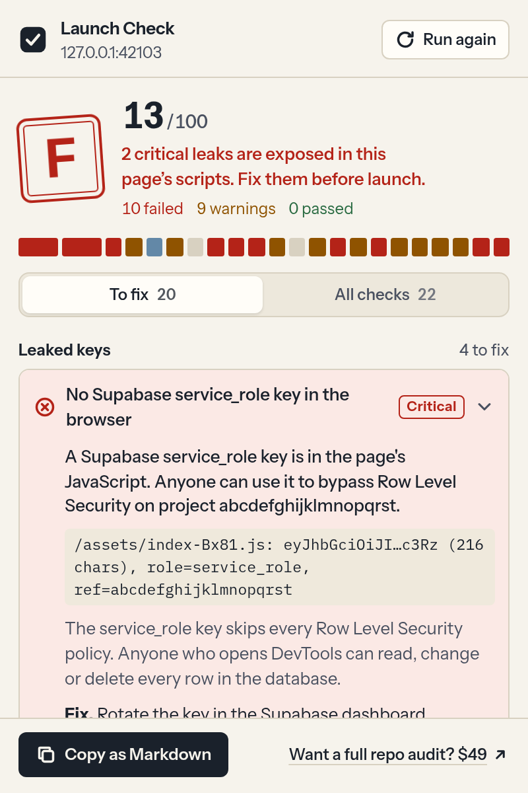

# Launch Check

A browser extension for the site you are about to launch. Open the site, click the toolbar button, and the popup
grades the page: missing SEO and sharing tags, weak security headers, mixed content, and secret keys that ended up
in the JavaScript the browser downloaded.

It works on Chrome, Edge and Firefox (Manifest V3, one source). This is a personal project by Sunnatulla E.



## What it checks

**Leaked keys** (read from the page's own scripts, never tried against any API)

- Supabase `service_role` JWT in the bundle. The JWT is decoded locally; a `service_role` key is a critical
  finding that caps the score at 39 (grade F). An `anon` key is only noted, with a reminder to check RLS.
- Supabase `sb_secret_` keys, Stripe secret/restricted keys (`sk_live_`, `sk_test_`, `rk_`), Stripe webhook
  secrets, OpenAI and Anthropic keys, GitHub tokens, AWS access key IDs.
- `.env` values bundled by Vite, Next.js and similar tools: names ending in `SECRET`, `PASSWORD`, `PRIVATE_KEY`,
  `SERVICE_ROLE_KEY` and so on, plus public-prefixed keys for paid APIs such as `VITE_OPENAI_API_KEY`.
- Public source maps, including whether they ship the full original source.

**Security headers** (from a same-origin GET of the page URL)

HTTPS, HSTS, Content-Security-Policy, clickjacking protection (`frame-ancestors` or `X-Frame-Options`),
`X-Content-Type-Options: nosniff`, Referrer-Policy, mixed content.

**Search and sharing**

Title, meta description, canonical URL, Open Graph, Twitter/X card, `robots.txt`, XML sitemap, favicon,
`html lang`, mobile viewport.

Every failed or warned check says what was found, why it matters, the fix, and copy-paste snippets for nginx,
Netlify, Vercel and Next.js where they apply. **Copy as Markdown** puts the whole report on the clipboard for an
issue or a PR. Found keys are always masked in the popup and in the report.

## What it never does

- No requests to Supabase, Stripe, OpenAI or any other third party. It does not test whether a key works.
- No background activity. Nothing runs until you click the button, and only on that tab.
- No analytics, no remote code, no accounts, no storage of results.
- It only fetches URLs on the inspected site's own origin: the page itself (to read its headers), `robots.txt`,
  the sitemap, `favicon.ico` when no icon is linked, the site's own scripts and their source maps. Scripts from
  other origins (CDNs, analytics) are listed as skipped.

See [PRIVACY.md](PRIVACY.md).

## Permissions

| Permission | Why |
|---|---|
| `activeTab` | Access to the current tab only, and only after you click the toolbar button. |
| `scripting` | Runs the read-only collector in that tab to read the DOM and fetch same-origin files. |

There are no host permissions and no content scripts, so the extension cannot see any page you did not click it on.

## Limits

- Scripts: up to 60 files, 3 MB each, 15 MB in total; requests time out after 8 s. Anything over the limits is
  listed as skipped.
- It sees the page you are on. Lazy chunks count only if the browser has already loaded them, so click through
  the app first for a fuller scan.
- It cannot see your database rules. A passing leak check does not mean your Supabase RLS policies are right.
- Header checks read the headers your server sends for a fresh GET of the page, which can differ from what a
  CDN serves to other regions.

## Build and test

Requires Node 22+.

```bash
npm ci
npm run build            # .output/chrome-mv3 (Chrome, Edge)
npm run build:firefox    # .output/firefox-mv3
npm run check            # typecheck, both builds, unit tests, web-ext lint
npm run e2e              # E2E build + popup tests in headless Chrome
npm run zip              # store zips (+ sources zip for AMO)
```

Load it unpacked: `chrome://extensions` (or `edge://extensions`) → Developer mode → Load unpacked →
`.output/chrome-mv3`. Firefox: `about:debugging` → This Firefox → Load Temporary Add-on → any file in
`.output/firefox-mv3`.

### How the tests work

- **Unit tests** (Vitest + happy-dom) run the real collector against fake sites in `test/fixtures`: a good page,
  a leaky page with a `service_role` JWT and a Stripe live key, missing headers, mixed content, the size caps and
  timeouts. All fake keys are assembled at runtime in `test/fixtures/keys.ts`, so no key-shaped string sits in
  the repo.
- **E2E** (`e2e/`) serves the same fixtures on `127.0.0.1`, loads the extension into headless Chrome with the
  CDP `Extensions.loadUnpacked` command, opens the popup and checks the grade, the critical finding, masking, the
  Markdown copy and keyboard use. `activeTab` needs a real toolbar click, so the E2E build (`E2E=1`, output in
  `.output-e2e/`) adds host access to `127.0.0.1` only. A unit test checks that the store manifests ask for
  `activeTab` and `scripting` and nothing else.
- `npm run screenshots` renders the popup images in `docs/screenshots`.

## Stack

TypeScript, [WXT](https://wxt.dev) 0.21 (Vite 7), Preact, Vitest, playwright-core, web-ext.

## Layout

```
src/core/collect.ts       collector injected into the tab (self-contained function)
src/core/secrets.ts       key patterns, local JWT decode, masking
src/core/leak-checks.ts   leak checks over the scanned scripts
src/core/page-checks.ts   header, HTTPS and SEO checks
src/core/catalog.ts       titles, weights, explanations, fix snippets
src/core/report.ts        score, grade, Markdown export
src/ui/, src/entrypoints/popup/   the popup (Preact)
```

## Full audit

The extension checks one page from the outside. If you want someone to go through the repository itself
(RLS policies, Stripe webhooks, server routes), the popup footer links to a paid $49 review by the author.

## License

MIT. Fonts: Instrument Sans and IBM Plex Mono, SIL Open Font License (`src/assets/fonts/LICENSE-fonts.txt`).
